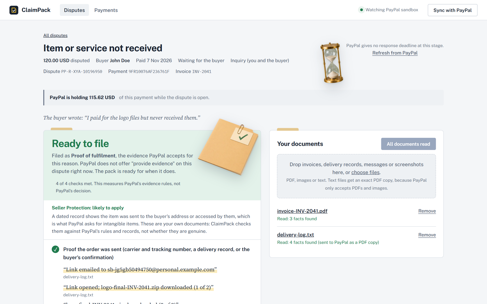
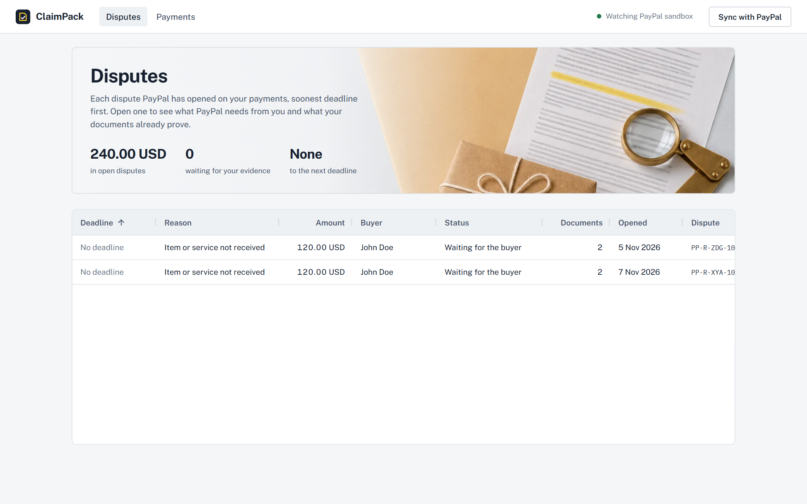
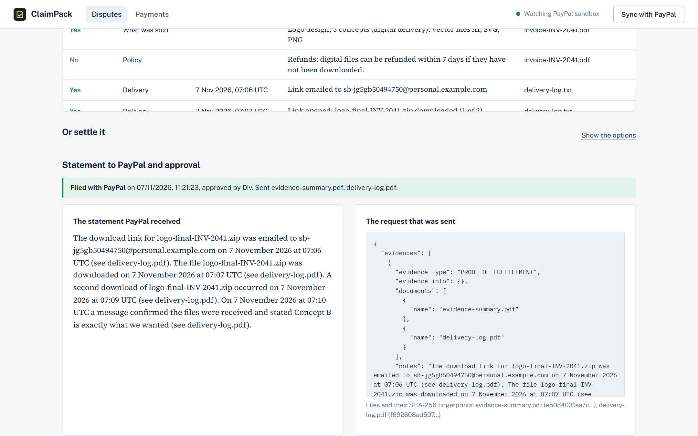
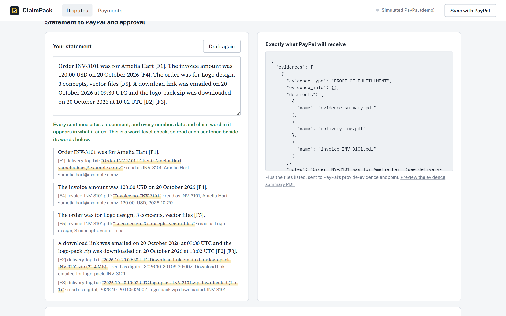
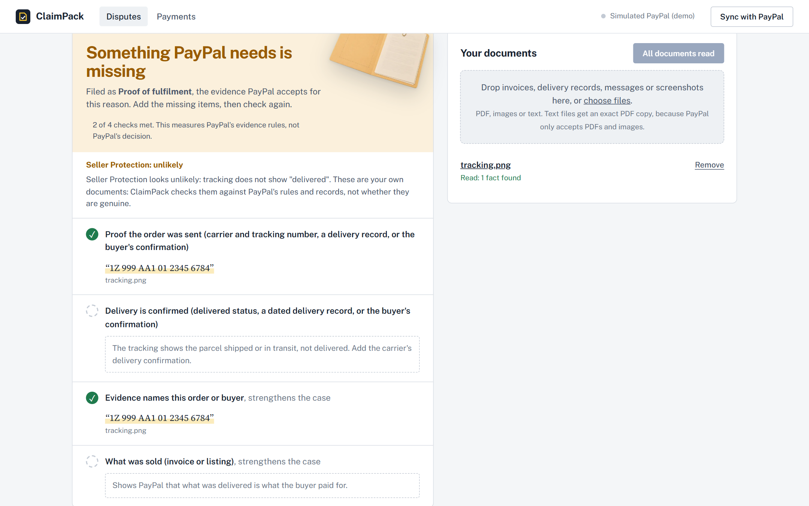
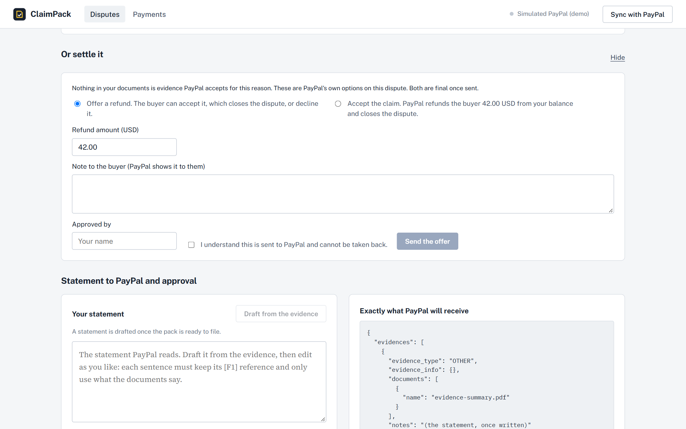
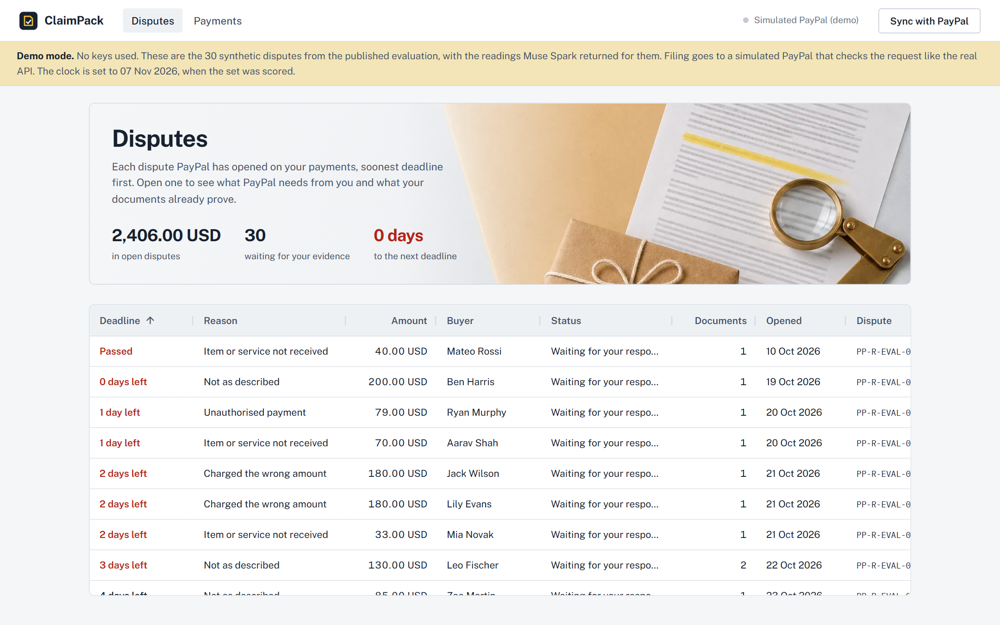

# ClaimPack

**When a buyer opens a PayPal dispute, ClaimPack builds the evidence pack PayPal asks for, checks it against PayPal's own rules for that dispute, shows the seller exactly what is missing, and, once a person approves, files it through the PayPal Disputes API.**

Built for the PayPal AI Hackathon (Devpost), solo, 5 to 12 November 2026. All data is from the PayPal sandbox or synthetic. Not legal or financial advice.

> The model reads. Code decides. A person approves.



| Disputes, soonest deadline first | What PayPal received, after a named person approved |
|---|---|
|  |  |
| **At approval: each sentence beside the exact words it cites** | **Not ready: what is missing, and the Seller Protection label** |
|  |  |
| **Nothing PayPal would accept: settle instead** | **Demo mode: the 30 evaluation disputes, no keys** |
|  |  |

---

## The problem

A solo seller who gets a PayPal dispute has one chance, a deadline, and a rulebook they have never read. PayPal accepts different evidence for different reasons: for *item not received* it wants proof of fulfilment (tracking, or documents showing delivery); for *not as described* it wants what was promised; a refund ID only counts if PayPal itself issued it. Evidence of the wrong type is rejected, and once evidence is filed at a stage, there is no second filing at that stage.

Chargeback agencies do this for large merchants and keep about a quarter of what they win back. Freelancers and small shops answer by hand, late, with whatever screenshot they can find.

## What ClaimPack does

1. **Keeps the proof when you are paid.** Every payment gets an evidence locker: the invoice, the delivery log, the buyer's messages. One click has Muse Spark read them, so a dispute arrives with its evidence already in place. Tracking found in those documents can be sent to the PayPal order itself (Orders v2 *add tracking*), where PayPal looks for it before any dispute.
2. **Notices the dispute.** ClaimPack watches PayPal (it checks the dispute list every 45 seconds; PayPal's signed webhooks are supported when PayPal can reach the server) and opens the case with PayPal's deadline, the buyer's words, and the money PayPal is holding.
3. **Reads every document.** Muse Spark 1.3 reads PDFs, photos and screenshots and returns facts, each with **the exact words it came from**. A document that contains instructions aimed at an AI is set aside, and the seller sees the text.
4. **Decides with PayPal's rules, not with the model.** A tested rules engine applies PayPal's published *reasons and evidence* table, the dispute's stage and the actions PayPal currently allows, and checks every fact against PayPal's own records: the order number, the buyer, the amount charged, refunds PayPal really issued, the deadline. Its verdict is one of **Ready to file**, **Something PayPal needs is missing** (and exactly what), **The evidence contradicts itself**, or **Nothing here PayPal would accept** (refunding is likely cheaper).
5. **Says whether Seller Protection is likely to apply.** Meeting PayPal's evidence rules and being covered by Seller Protection are different tests, so ClaimPack shows both. For example, item-not-received on a physical order needs a *delivered* status and date; a digital order needs a dated record of access; *not as described* and card-issuer claims are not covered at all. It is a label with reasons, not a prediction.
6. **Drafts the statement, then checks it.** Muse Spark writes a short, factual statement from the facts the engine chose. Code rejects any sentence that cites nothing. It also rejects any number, date, time, link, email, name, quotation or claim word (*confirmed*, *received*, *agreed*, *refunded*…) that the cited documents do not contain, and any accusation against the buyer. At approval each sentence is shown beside the exact words it cites.
7. **Or settles it.** When the evidence will not carry the claim, ClaimPack shows PayPal's own alternatives on that dispute, offering a refund or accepting the claim, with the same named approval.
8. **A person approves, then ClaimPack files.** The seller sees the exact request PayPal will receive, types their name and confirms. ClaimPack re-checks everything on the server (the pack must still be the one they reviewed), sends the evidence through `provide-evidence` with a generated evidence-summary PDF, reads the dispute back and logs what was sent, by whom, with file fingerprints.

## Proof it works against PayPal (sandbox, 7 November 2026)

| Step | What happened |
|---|---|
| Sale | Test sale made from ClaimPack's own checkout, invoice `INV-2041` sent as PayPal's `invoice_id`; payment `9FR10076AF236761F` captured 07:05:59 UTC |
| Before any dispute | The seller's invoice PDF and delivery log were added to that payment's locker and read by Muse Spark (2.7 cents) |
| Dispute | The sandbox buyer opened *item not received* in PayPal's Resolution Center: `PP-R-XYA-10196950`, 07:13 UTC |
| ClaimPack | Picked it up from PayPal about 3.5 minutes later (when PayPal allowed seller evidence); verdict **Ready to file**, every check met, no warnings; the delivery log shows the files downloaded twice and the buyer writing "Got the files, thanks!" three minutes before the dispute |
| Approval and filing | The seller drafted, read and approved the statement in ClaimPack; `provide-evidence` returned 200 |
| PayPal's record | Read back from PayPal: `SUBMITTED_BY_SELLER`, `PROOF_OF_FULFILLMENT`, documents `evidence-summary.pdf` and `delivery-log.pdf`; status `WAITING_FOR_BUYER_RESPONSE` |

The proof bundle in [`docs/proof/2026-11-07-PP-R-XYA-10196950/`](docs/proof/2026-11-07-PP-R-XYA-10196950/) has the request sent, PayPal's record read back today, and the SHA-256 of each file PayPal holds: **byte-identical** to what ClaimPack logged sending.

## Measured on 30 synthetic disputes

Thirty disputes across seven of PayPal's dispute reasons, each with the documents a real seller might hold: invoice PDFs, delivery logs, carrier tracking pages and chat conversations **as images**, listings, refund emails, contracts and subscription terms (39 documents, all stamped SPECIMEN). Planted traps: tracking for another order, a parcel delivered to someone else, an invoice that disagrees with what PayPal charged, a refund ID PayPal never issued, instructions to the AI hidden in a delivery log and in a listing, a missed deadline, a carrier PayPal does not list, a delivery after the complaint, and dates written without a year. The real pipeline ran on every case: Muse Spark read each document, the rules engine decided, and for every case judged ready the drafter wrote a statement checked by the guard.

| | First run | After two fixes (same saved readings) | After the five reviews (v2: same readings, stricter rules and guard, statements redrafted) |
|---|---|---|---|
| Verdicts right | 28 / 30 | **30 / 30** | **30 / 30** |
| Evidence type right (ready cases) | 17 / 17 | 17 / 17 | 16 / 16 |
| Right documents attached, and never a document that must not go to PayPal | 29 / 30 | 30 / 30 | 30 / 30 |
| Hidden instructions to the AI caught | 2 / 2 | 2 / 2 | 2 / 2 |
| Clean documents wrongly set aside | 0 | 0 | 0 |
| **Dangerous errors** (would let a person file a pack that is not ready, or attach a document that must not be sent) | **0** | **0** | **0** |
| Drafted statements passing the guard | 15 / 15 (14 first attempt) | 17 / 17 (16 first attempt) | 16 / 16 (14 first attempt) |

Cost: reading the 39 documents cost $0.38, once; v2 reused those readings. Drafting cost $0.12, and redrafting for v2 another $0.11. A replay re-scores saved readings but does not redraft, so it reports statements as not run.

**One answer key was changed after the reviews.** Case c06 (tracking that still says *in transit*) was marked *Ready to file* in the first two runs. The PayPal-expert review pointed out that Seller Protection for item-not-received needs a *delivered* status, so the expected answer is now *Something PayPal needs is missing*. That makes v2's 30 / 30 partly the result of rules written after seeing the cases. It is not a held-out score.

**The two first-run failures, and what changed:**
- *Dates written without a year* (`05/10 08:45`). The reader correctly refused to guess a year, so both deliveries were dropped and the case fell to "no defence". Fix: the reader keeps the line as written and code picks the reading (day-first or month-first, which year) nearest the payment date, then **tells the seller what it assumed** so they can check it (`src/rules/dates.ts`, with tests).
- *A case with a deadline already passed.* My own test case: the dispute's 20-day deadline expired on the morning of the scoring date, and ClaimPack correctly said so. The case's dates were corrected.

Because those fixes were made after seeing the test, the second column is not a held-out score. All three runs are published: `eval/runs/published-2026-11-07-first-run/`, `eval/runs/published-2026-11-07/` and `eval/runs/published-2026-11-07-v2/`, with every reading the model returned. The set was written by the builder, so it shares the builder's blind spots, and the tracking pages and chats are rendered by code, not photographed. Re-score it yourself, free and without keys: `REPLAY=published-2026-11-07-v2 npx tsx scripts/eval/run.ts` (it writes `results-replay.json` and never overwrites the published results).

## How PayPal is used

| PayPal capability | Endpoint | What ClaimPack does with it |
|---|---|---|
| OAuth 2.0 | `POST /v1/oauth2/token` | Server-side token, cached; credentials never reach the browser |
| Disputes: list and show | `GET /v1/customer/disputes`, `GET /v1/customer/disputes/{id}` | Watches for new disputes; reads reason, stage, deadline, the buyer's words, items, seller-protection flag and the **HATEOAS links** that say what the seller may do now |
| Disputes: provide evidence | `POST /v1/customer/disputes/{id}/provide-evidence` (multipart) | Files the approved pack: evidence type, `tracking_info` or `refund_ids`, notes, and the documents |
| Payments | `GET /v2/payments/captures/{id}`, `GET /v2/checkout/orders/{id}` | Finds refunds PayPal really issued for the payment (only `COMPLETED` ones count) and money PayPal is holding |
| Orders | `POST /v2/checkout/orders`, `.../capture` | The test checkout, which sends the seller's own invoice number as `invoice_id` so evidence can be matched to the payment |
| Webhooks | `POST /v1/notifications/verify-webhook-signature` | `CUSTOMER.DISPUTE.*` and `PAYMENT.CAPTURE.COMPLETED` are accepted only after PayPal verifies the signature, and de-duplicated by event id |

### What the sandbox taught us (and what ClaimPack does about it)

- A buyer's complaint immediately puts the payment on hold (`PENDING`, reason `BUYER_COMPLAINT`) with a pending reversal of the net amount. ClaimPack shows it as money held, and never counts it as a refund.
- In the inquiry stage, `OTHER` evidence for *item not received* is refused (`EVIDENCE_TYPE_IS_NOT_ALLOWED`); `PROOF_OF_FULFILLMENT` is accepted. The rules engine encodes PayPal's table so the wrong type is never offered.
- PayPal's documentation accepts `.jpg .jpeg .gif .png .pdf` under 10 MB. The sandbox also accepted a `.txt`; ClaimPack does not rely on that and sends a faithful PDF copy of any text evidence.
- PayPal masks email addresses in the seller's notes (`xxxx`), so the drafter leaves them out.
- Without an `invoice_id` on the order, PayPal's record has no invoice number, and a seller's documents cannot be tied to the payment by order number. ClaimPack says so and asks sellers to send it.
- Creating a dispute through the API as a buyer needs extra scopes from a PayPal account manager, so disputes for testing are opened in the sandbox Resolution Center, exactly as a real buyer would.

## The AI, and how it is kept honest

- **Model:** Meta Muse Spark 1.3 (`muse-spark-1.3`) through the Meta Model API: vision and PDF input, strict JSON-schema output. About 1 to 3 cents per document and about 1 cent per statement.
- **The reader** returns typed facts with the exact quote and page; rows missing what their kind needs are dropped and counted.
- **Prompt injection:** text addressed to an AI ("ignore your instructions…") puts the whole document aside. Nothing from it is used or attached, and the seller sees why.
- **The model never decides.** Verdicts, evidence types, attachments and the deadline are code (`src/rules/engine.ts`), unit-tested against PayPal's published rules.
- **The statement guard** (`src/rules/statement.ts`, `src/rules/claims.ts`) is code too. Every sentence must cite a fact. No number, number word, currency, date, relative time, link, email, capitalised name or quotation is allowed unless the cited documents contain it (document ids never count as evidence). Claim words such as *confirmed*, *agreed* or *refunded*, and negations, need a cited fact that supports them. No accusations. **It checks words, not meaning:** a sentence can use only supported words and still arrange them into something the documents do not say. That is why the approver sees every sentence beside the words it cites, and why a person, not the guard, approves.
- **Filing is gated four times on the server:** the pack is *Ready*, PayPal currently offers `provide_evidence`, a named person approved, and the plan hash matches what that person reviewed.

## Reviewed from five angles

Before submitting, the project went to five independent reviewers, each with one brief: hackathon judges, an adversary trying to make it file something false, a PayPal disputes specialist, small sellers, and a presentation critic. Their attacks became tests. **120 tests now pass**, including the reviewers' own cases in `tests/review/`: forged refund IDs, another buyer's tracking, failed deliveries, ambiguous dates, invented quotations, claim words the documents never support, and oversized or misnamed files.

What changed because of them:
- the Seller Protection label;
- delivered-status rules;
- refunds matched to the exact capture and currency;
- a stricter word-level guard;
- file names PayPal's API accepts;
- text documents sent as PDFs (PayPal's documented formats);
- the dispute re-fetched from PayPal immediately before filing;
- an evidence fingerprint, so the approved pack is provably the one sent.

## Who it is for

PayPal reports 439 million active consumer and merchant accounts (10-K, FY2025). Each PayPal-account dispute costs the seller a $15 fee ($30 for higher-volume sellers), and a seller who does not respond in time loses by default if the buyer escalates. Large merchants hand disputes to chargeback agencies that keep 20 to 25% of what they win back. A freelancer with six disputes a year is not worth an agency's time, so they answer by hand.

ClaimPack gives that seller the discipline an agency applies:
- it watches PayPal for the dispute;
- it checks the seller's documents against PayPal's published evidence rules for that reason;
- it says exactly what is missing, or that refunding is cheaper;
- it files through the Disputes API only after the seller approves.

## Try it in two minutes, no keys

```bash
git clone https://github.com/bsjuilla/claimpack.git
cd claimpack
npm install
npm run demo              # http://127.0.0.1:8790
```

Demo mode needs no PayPal account and no Meta key. It loads the 30 synthetic disputes from the published evaluation with the readings Muse Spark returned for them, and sets the clock to the date the set was scored, so every deadline reads as it did then. Open any dispute to see the verdict, the Seller Protection label and the exact words that fill each requirement. On a ready case, press **Draft** to load the statement Muse Spark wrote in that run, edit it to try to slip something past the guard, then approve and **File**. Filing goes to a simulated PayPal that checks the request the way the real API does (file names, formats, sizes, one filing per stage) and records it. Nothing leaves your computer, and each start begins fresh in `data-demo/`. A test (`tests/demo.test.ts`) checks that the demo gives every case its expected verdict.

## Run it against the PayPal sandbox

You need Node.js 22.5 or later, a PayPal developer account with a **sandbox** app (developer.paypal.com, Apps & Credentials, Sandbox), and a Meta Model API key for the AI steps.

```bash
git clone https://github.com/bsjuilla/claimpack.git
cd claimpack
npm install
cp .env.example .env      # then add your PayPal sandbox client ID and secret, and META_API_KEY
npm test                  # 120 tests: rules engine, statement guard, PayPal parsing, reviewers' attacks, demo
npm run app               # builds the web app and starts http://127.0.0.1:8790
```

Then, in the app:

1. **Payments, Make a test sale.** Approve it as your sandbox *personal* (buyer) account; you return to the payment's evidence locker.
2. Add the seller's documents (an invoice, a delivery log, a chat screenshot) and press **Read**.
3. As the sandbox buyer, open **sandbox.paypal.com, Resolution Center, Report a problem** on that payment.
4. Within a few minutes the dispute appears in **Disputes** by itself. Open it, draft the statement, approve with your name and **File evidence with PayPal**.

**Without any keys** you can still run the tests and re-score the published evaluation from its saved readings:

```bash
npm test
REPLAY=published-2026-11-07-v2 npx tsx scripts/eval/run.ts
```

To re-run the evaluation live (about $1 of Meta API credit): `npx tsx scripts/eval/build.ts` then `DRAFT=1 npx tsx scripts/eval/run.ts`.

## Security

- The server listens on `127.0.0.1` only. API requests from other hosts or other websites are refused (DNS rebinding and cross-site request protection).
- PayPal credentials and the Meta key stay in `.env` on the server; nothing secret reaches the browser.
- Uploads: allow-listed types whose bytes must match the extension (a renamed file is refused), 10 MB limit, sanitised names, files stored by content hash, never executed.
- Webhooks are trusted only after PayPal verifies their signature.

## Limits (said plainly)

- The Seller Protection label follows PayPal's published policy. It is not PayPal's decision and can be wrong where the policy leaves things to PayPal.
- Everything here is sandbox or synthetic. ClaimPack measures whether a pack meets PayPal's published rules; it cannot measure whether PayPal will decide in the seller's favour, and it does not claim to.
- Documents are uploaded or dropped in; there is no inbox integration.
- Sending tracking and settling (offer a refund, accept the claim) are tested against the simulated PayPal and unit tests, not yet against the PayPal sandbox.
- The evaluation set was written by the builder, so it shares the builder's blind spots. Its failures are listed above, not hidden.
- PayPal's sandbox accepted one evidence filing per dispute stage in our tests; ClaimPack treats every filing as final.

## Credits

Built solo during the PayPal AI Hackathon, 5 to 12 November 2026, by Divyesh Kumar Khadun. The illustrations (folders, receipts, parcel, hourglass, loupe and the desk photograph) were generated with an AI image model from prompts written for this project. Data grid: AG Grid Community (MIT). Licence: MIT.
